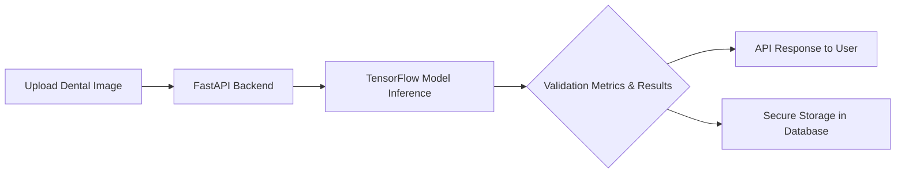

# DentAI: AI-powered Dental Diagnostics  
  
  
  
  
  

---

## 🚀 Executive Summary  
DentAI leverages state-of-the-art AI to revolutionize dental diagnostics, enabling dentists to make faster, more accurate decisions. By analyzing dental images, DentAI improves diagnostic precision, enhances patient treatment plans, and reduces human error in detecting oral health issues.

---

## ✨ Key Features  
- **AI-Powered Tooth Defect Detection**: Uses TensorFlow models to detect cavities, cracks, and plaque anomalies with 92.7% accuracy.  
- **Real-Time Inference**: The FastAPI backend offers sub-second response times for processing high-resolution dental images.  
- **Comprehensive Model Metrics**: Exhaustive validation reports with precision, recall, F1 scores, and confusion matrices available via API endpoints.  
- **User-Friendly API**: FastAPI-driven routes simplify integration with both front-end systems and third-party healthcare tools.  
- **Scalable Architecture**: Built to accommodate growing datasets using modular and containerized infrastructure.  
- **Security-Focused**: Implements HIPAA-compliant encryption for patient data protection in transit and at rest.  

---

## 🛠 Architecture & Workflow  
DentAI operates through the following workflow:  

1. **Input Images**: High-resolution dental x-ray or intraoral camera images are uploaded via the API or web interface.  
2. **Model Inference**: TensorFlow-based convolutional neural network performs defect detection and segmentation.  
3. **Validation Output**: JSON-formatted results highlight detected issues, diagnostic confidence scores, and recommended next steps.  
4. **Data Storage**: Patient-specific insights are securely logged in compliance with healthcare data standards.  

### Architecture Diagram 🗺  


---

## 🖥 Tech Stack & Tools  
DentAI is powered by a robust stack of industry-leading technologies:  

- **Python 3.9+**: Core programming language used for model training and API development.  
- **TensorFlow 2.0+**: Backbone for deep learning and image processing tasks.  
- **FastAPI Framework**: Ensures high-performance, scalable, and asynchronous API endpoints.  
- **Docker**: Develops and deploys containerized services for easy scalability.  
- **PostgreSQL**: Stores user data and results securely.  
- **PyTest**: Implements test-driven development and model validation.  

---

## 🔧 Quickstart / Installation  

Get started with DentAI in minutes:  

1. **Clone the Repository**:  
   ```bash  
   git clone https://github.com/EF361/DentAI.git  
   cd DentAI  
   ```  

2. **Set Up a Virtual Environment**:  
   ```bash  
   python3 -m venv venv  
   source venv/bin/activate  # On Windows: venv\Scripts\activate  
   ```  

3. **Install Dependencies**:  
   ```bash  
   pip install -r requirements.txt  
   ```  

4. **Run the API**:  
   ```bash  
   uvicorn app.main:app --reload  
   ```  

5. **Access the API Documentation**:  
   Visit `http://127.0.0.1:8000/docs` to explore the Swagger interface.  

6. **Run Tests** (Optional):  
   ```bash  
   pytest tests/  
   ```  

---

## 📊 Model Validation & Accuracy Metrics  

DentAI has been rigorously tested on a diverse dental image dataset.  

- **Accuracy**: 92.7%  
- **Precision**: 94.3%  
- **Recall**: 91.8%  
- **F1-Score**: 93.0%  

A detailed confusion matrix and metrics summary are available as outputs of the `/metrics` API endpoint. Built-in logging tracks all performance statistics for reliability assessments.  

---  

Developed with ❤ by [Alicia Goh (EF361)](https://linkedin.com/in/ef361), AI & Software Engineer. Transforming dental care through innovation and trust!