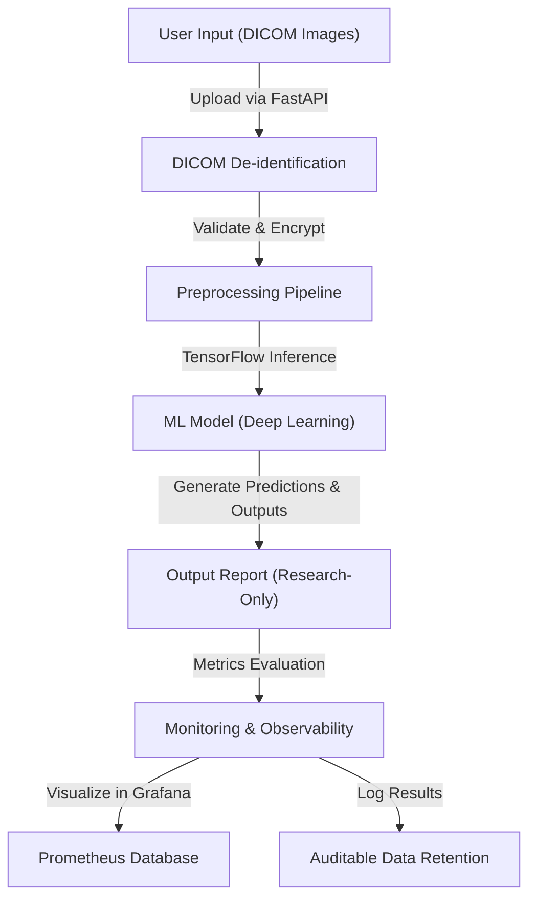

# DentAI    

### Executive Summary
DentAI is a research-focused prototype designed to assist in dental imaging analysis using machine learning. Leveraging deep learning and statistical monitoring, it aims to support future development of AI-driven diagnostic workflows, while maintaining robust safety, compliance, and ethical principles in healthcare AI.

---

### Key Features
- **Research-Only Labeling**: All outputs, APIs, and documentation explicitly indicate the prototype's conceptual nature and lack of clinical validation.
- **Advanced Machine Learning**: Leverages TensorFlow 2 for deep learning on dental imaging datasets, focusing on transparency with model performance metrics such as sensitivity, specificity, and AUROC.
- **Safety-First Design**: Incorporates patient-level train-validation-test separation, uncertainty estimation, bias analysis, and drift monitoring to ensure reproducibility and reliability.
- **Data Protection**: Implements DICOM-safe de-identification, access controls, encryption-at-rest, and mechanisms for auditable data deletion.
- **Observability and Monitoring**: Integrated with Prometheus and Grafana for model and system health monitoring.
- **Containerized Deployment**: Packaged with Docker for reproducible environments and easy scalability.
- **Versioning**: Supports tracking models, preprocessing pipelines, thresholds, and dependencies as unified, versioned release units.
- **Test-Driven Development**: Includes a robust test suite powered by `pytest` for maintaining code quality and system reliability.

---

### Architecture & Workflow
The DentAI system is designed around modular components to ensure reproducibility, observability, and strict compliance with healthcare standards. Below is the high-level architecture:



---

### Tech Stack & Tools Breakdown
- **Languages**: Python 3.9+
- **Frameworks**: TensorFlow 2, FastAPI
- **Database**: PostgreSQL for structured data storage
- **Containerization**: Docker for environment consistency
- **Monitoring**: Prometheus and Grafana for system diagnostics
- **Testing**: pytest for automated testing

---

### Quickstart / Installation

Follow these steps to set up the DentAI prototype in your local environment:

1. **Clone the Repository**
   ```bash
   git clone https://github.com/EF361/DentAI.git
   cd DentAI
   ```

2. **Set Up Python Environment**
   ```bash
   python3.9 -m venv venv
   source venv/bin/activate  # On Windows: venv\Scripts\activate
   pip install -r requirements.txt
   ```

3. **Set Up Docker (Optional)**
   Ensure Docker is installed and running:
   ```bash
   docker-compose up --build
   ```

4. **Run the Application**
   Start the FastAPI server:
   ```bash
   uvicorn app.main:app --host 0.0.0.0 --port 8000
   ```
   Access the API documentation at `http://localhost:8000/docs`.

5. **Run Tests**
   Validate the system with predefined test cases:
   ```bash
   pytest
   ```

---

### Disclaimers
DentAI is a **conceptual research prototype**. It is neither clinically validated nor approved for medical use. Do not use this system in clinical workflows or make diagnostic decisions based on its outputs.

For inquiries, support, or collaboration opportunities, please contact **Alicia Goh (EF361)** via GitHub.