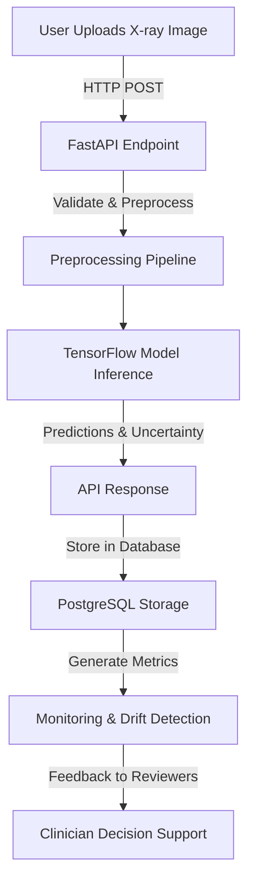

# DentAI


## Executive Summary

DentAI leverages state-of-the-art machine learning to assist dental professionals with the detection of oral pathologies from X-ray images. Designed as a decision-support tool, DentAI combines modern APIs, robust databases, and secure infrastructure to deliver reliable predictions while following healthcare best practices.

## Key Features

- **AI-Powered Decision Support:** TensorFlow-based deep learning models trained and evaluated on curated dental imagery datasets to identify potential oral pathologies.
- **FastAPI for Inference:** A performant, scalable API handling image uploads and returning structured inference results, including uncertainty scores.
- **Reproducible Workflows:** Fully versioned model artifacts and pipelines with fixed random seeds, environment locks, and containerized infrastructure.
- **Integrated Database:** PostgreSQL backend for managing user data, results storage, and audit logging, ensuring system reliability and compliance.
- **Comprehensive Testing:** Pytest suite for unit, integration, and API-level tests, including edge cases like invalid file uploads, oversized images, adversarial inputs, and concurrent load performance.
- **Security and Privacy:** Designed with healthcare-grade security recommendations and explicit adherence to decision-support framing (not diagnosis).
- **Extensive Performance Metrics:** Detailed model performance evaluations, including sensitivity, specificity, precision, recall, confidence intervals, per-condition analysis, and calibration performance.
- **Quality Assurance:** Model cards, bias analysis, and limitations documented for transparent AI governance.
- **Monitoring and Drift Detection:** Continuous monitoring of model performance with alerts for data drift or out-of-distribution inputs.

## Architecture & Workflow



## Tech Stack & Tools Breakdown

| Component             | Technology                                                                 |
|-----------------------|---------------------------------------------------------------------------|
| Programming Language  | Python 3.9+                                                              |
| Machine Learning      | TensorFlow 2.x                                                          |
| API Framework         | FastAPI                                                                 |
| Database              | PostgreSQL                                                              |
| Containerization      | Docker                                                                  |
| Testing               | Pytest                                                                  |
| Monitoring/Logging    | Prometheus, Grafana (planned roadmap)                                   |

## Quickstart / Installation

Follow these steps to set up DentAI for local development or deployment.

### Prerequisites
- [Python 3.9+](https://www.python.org/downloads/)
- [Docker](https://www.docker.com/products/docker-desktop)
- [PostgreSQL](https://www.postgresql.org/download/)

### Steps

1. **Clone the Repository**
   ```bash
   git clone https://github.com/username/DentAI.git
   cd DentAI
   ```

2. **Set Up Python Virtual Environment**
   ```bash
   python -m venv venv
   source venv/bin/activate  # or venv\Scripts\activate on Windows
   pip install -r requirements.txt
   ```

3. **Start PostgreSQL Backend**
   ```bash
   docker-compose up -d
   ```

4. **Run the Application**
   ```bash
   uvicorn app.main:app --reload
   ```

5. **Run Tests**
   ```bash
   pytest
   ```

6. **Access the API**
   - Navigate to `http://127.0.0.1:8000/docs` for the interactive API documentation.

## Contributing

We welcome contributions! Please see the [CONTRIBUTING.md](CONTRIBUTING.md) file for guidelines on code submissions, feature requests, and bug reports.

## Acknowledgments

DentAI development is spearheaded by Alicia Goh (EF361) with insights from interdisciplinary healthcare and software engineering teams. The project adheres to safe, transparent, and ethical AI practices to improve patient outcomes responsibly.

## Legal Disclaimer

DentAI is a decision-support tool and not a certified diagnostic system. All outputs must be reviewed by qualified clinical professionals. Additionally, the repository does **not claim HIPAA compliance**; deployment requires independent verification of compliance controls. See [LICENSE](LICENSE) for more details.